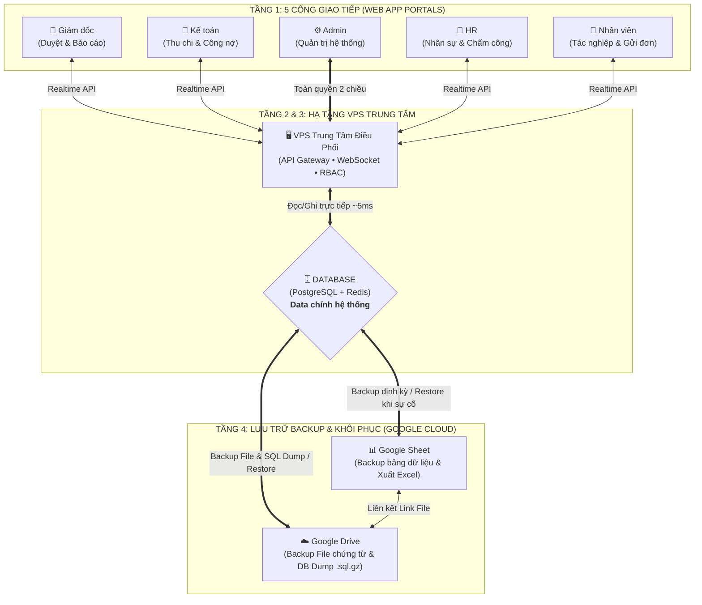

# BỘ PROMPT MẪU: HỆ THỐNG 5 CỔNG - VPS - DATABASE CHÍNH & BACKUP SHEET/DRIVE

Tài liệu này bao gồm **3 Prompt chuyên dụng** tùy theo mục đích sử dụng của bạn:
1. **Prompt 1:** Dùng để tạo lại **Giao diện Sơ đồ Kiến trúc Tương tác (HTML/Tailwind/JS)** như bản thiết kế trên màn hình.
2. **Prompt 2:** Dùng cho **Cursor / Claude / ChatGPT** để viết toàn bộ code **Backend + Database + Đồng bộ Google Sheet & Drive**.
3. **Prompt 3:** Dùng để vẽ nhanh sơ đồ bằng **Mermaid.js / Draw.io** phục vụ làm tài liệu báo cáo.

---

## 1. Prompt tạo Sơ đồ Kiến trúc Tương tác (Web App Visualizer)
*Copy đoạn prompt dưới đây nếu bạn muốn yêu cầu AI tạo lại hoặc tùy biến thêm giao diện mô phỏng kiến trúc:*

```text
Hãy đóng vai một Senior System Architect và Frontend Developer. Hãy viết cho tôi một ứng dụng Single-File HTML (sử dụng Tailwind CSS và FontAwesome) để mô phỏng trực quan "Sơ Đồ Kiến Trúc Hệ Thống Doanh Nghiệp (Master DB + Cloud Disaster Recovery)" theo cấu trúc 4 tầng từ trên xuống dưới như sau:

1. TẦNG 1 (5 Cổng giao tiếp - Role Portals):
- Gồm 5 khối nằm ngang: [Giám đốc], [Kế toán], [Admin], [HR], [Nhân viên].
- Mũi tên kết nối: 
  + Nhánh trái: [Giám đốc] và [Kế toán] hội tụ đi vào bên trái của VPS.
  + Trục giữa: [Admin] kết nối mũi tên 2 chiều trực tiếp vào chính giữa VPS.
  + Nhánh phải: [HR] và [Nhân viên] hội tụ đi vào bên phải của VPS.

2. TẦNG 2 (Trung tâm điều phối - VPS):
- Khối [VPS] nằm ở trung tâm, đóng vai trò là API Gateway, WebSocket Server (truyền dữ liệu realtime <20ms giữa 5 cổng), phân quyền RBAC và chạy Background Worker.

3. TẦNG 3 (Database chính):
- Nối 2 chiều trực tiếp từ [VPS] xuống một khối hình thoi (Diamond shape) tên là [Database (PostgreSQL + Redis)].
- Có ghi chú rõ bên cạnh: "Data chính hệ thống" - nơi lưu trữ và xử lý toàn bộ dữ liệu vận hành tức thời của 5 cổng.

4. TẦNG 4 (Backup & Khôi phục thảm họa - Sheet & Drive):
- Từ đáy khối hình thoi [Database], vẽ đường trục đi xuống và rẽ nhánh sang 2 khối: [Google Sheet] (bên trái) và [Google Drive] (bên phải), đồng thời có mũi tên liên kết 2 chiều giữa Sheet và Drive.
- Ghi chú trên đường nối: "Backup định kỳ & Khôi phục (Restore) khi có sự cố".

YÊU CẦU TÍNH NĂNG TƯƠNG TÁC TRÊN GIAO DIỆN:
- Thiết kế giao diện Dark Mode hiện đại, chuyên nghiệp.
- Có 3 nút bấm mô phỏng hiệu ứng chạy dữ liệu (Animation đường kẻ đứt nét chuyển động + Nhật ký System Logs thời gian thực):
  + Kịch bản 1: Truyền dữ liệu tức thời giữa 5 Cổng <-> VPS <-> Database chính.
  + Kịch bản 2: Tự động Backup dữ liệu bảng xuống Google Sheet và lưu file chứng từ / file dump (.sql.gz) xuống Google Drive.
  + Kịch bản 3: Khôi phục (Restore) dữ liệu từ Google Drive và Google Sheet ngược lên lại Database khi VPS gặp sự cố.
- Khi click vào bất kỳ khối nào trên sơ đồ, hiển thị bảng giải thích chi tiết vai trò kỹ thuật của khối đó ở cột bên phải.
- Có thêm các Tab phụ: "Ma trận phân quyền 5 cổng", "Quy trình Backup & Restore", và "Cấu hình Docker PostgreSQL + Redis + Rclone miễn phí trên VPS".
```

---

## 2. Prompt yêu cầu AI viết Code Hệ thống thực tế (Dùng cho Cursor / Windsurf / Claude / ChatGPT)
*Copy đoạn prompt này dán vào công cụ lập trình AI khi bạn bắt đầu xây dựng dự án thực tế trên VPS:*

```text
Tôi đang xây dựng một hệ thống Web App quản trị doanh nghiệp nội bộ chạy trên VPS Linux. Hãy đóng vai trò là Principal Backend Engineer và thiết kế cấu trúc dự án + viết code khởi tạo theo đúng kiến trúc sau:

1. KIẾN TRÚC TỔNG THỂ:
- 5 Cổng người dùng (Portals) phân quyền theo RBAC: Giám đốc (DIRECTOR), Kế toán (ACCOUNTANT), Quản trị viên (ADMIN), Nhân sự (HR), Nhân viên (EMPLOYEE).
- Backend đặt trên VPS: Sử dụng Node.js (NestJS hoặc Express) + Socket.io (WebSockets) để truyền dữ liệu và thông báo tức thời giữa 5 cổng.
- Database chính (Master DB) cài trên VPS qua Docker:
  + PostgreSQL 16 (quản lý qua Prisma ORM) làm nơi đọc/ghi dữ liệu chính thức của toàn hệ thống.
  + Redis 7 làm bộ đệm (Cache), quản lý phiên đăng nhập và làm hàng đợi (BullMQ) cho tác vụ đồng bộ ngầm.

2. CƠ CHẾ BACKUP & KHÔI PHỤC VỚI GOOGLE SHEET & GOOGLE DRIVE:
- Lưu ý quan trọng: 5 cổng Web App CHỈ đọc/ghi trực tiếp vào PostgreSQL trên VPS để đạt tốc độ phản hồi < 20ms. Tuyệt đối không bắt người dùng chờ Google API.
- Chiều Backup (DB -> Sheet & Drive):
  + Mỗi khi có bản ghi mới/cập nhật trong PostgreSQL, đẩy job vào Redis Queue (BullMQ) hoặc chạy Cronjob mỗi 30 giây để gom các bản ghi có `is_synced_to_sheet = false` và Batch Update sang Google Sheets qua Google Sheets API v4 (sử dụng Service Account).
  + Các file đính kèm (hóa đơn kế toán, hợp đồng HR) được upload qua VPS và đẩy lên thư mục Google Drive qua Google Drive API (hoặc Rclone), sau đó lưu `drive_file_url` vào PostgreSQL và Google Sheet.
  + Thiết lập Cronjob hàng ngày chạy `pg_dump` nén Database thành file `.sql.gz` và đẩy lên Google Drive.
- Chiều Khôi phục / Disaster Recovery (Drive & Sheet -> DB):
  + Xây dựng API dành riêng cho cổng ADMIN: Cho phép khôi phục Database từ bản dump `.sql.gz` trên Google Drive và một API đối soát/đồng bộ bù (Delta Sync) các dòng dữ liệu mới nhất từ Google Sheets (dựa vào cột khóa chính `id` chuẩn UUID và `updated_at`) ngược vào lại PostgreSQL khi cần thiết.

3. YÊU CẦU ĐẦU RA:
- Hãy cung cấp cho tôi:
  1. File `docker-compose.yml` để khởi chạy PostgreSQL và Redis trên VPS.
  2. File `schema.prisma` mẫu bao gồm bảng `User` (5 roles), bảng nghiệp vụ mẫu (ví dụ `ApprovalRequest` hoặc `FinancialTransaction`) có đầy đủ các trường phục vụ đồng bộ (`id` UUID, `isSyncedToSheet`, `sheetRowNumber`, `driveFileUrl`, `updatedAt`).
  3. Code mẫu của Worker đồng bộ 2 chiều giữa PostgreSQL và Google Sheets/Drive.
```

---

## 3. Prompt vẽ sơ đồ dạng mã Mermaid (Dùng cho Notion, GitHub, Draw.io)
*Nếu bạn muốn chèn sơ đồ kiến trúc của bạn vào tài liệu Word, Notion, hoặc dán vào trang `mermaid.live` để xuất ảnh PNG/SVG chất lượng cao:*

